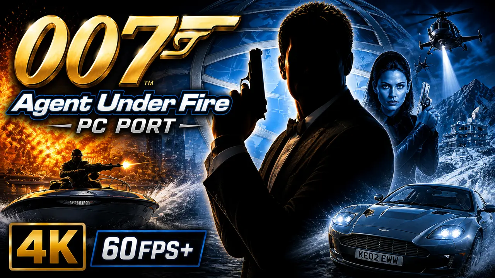
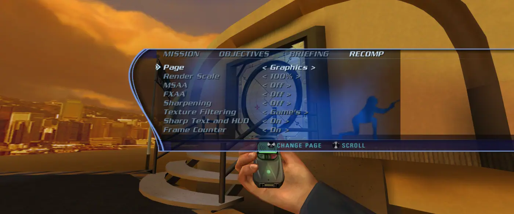
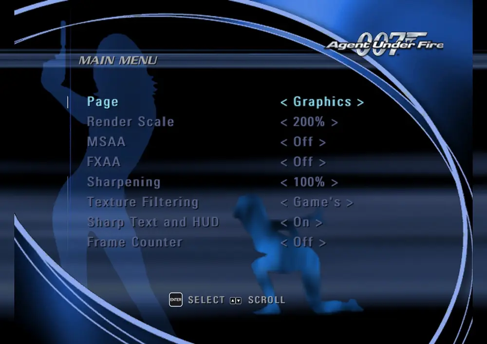
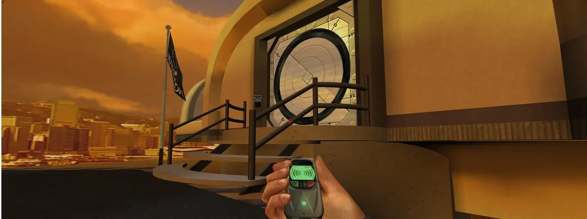
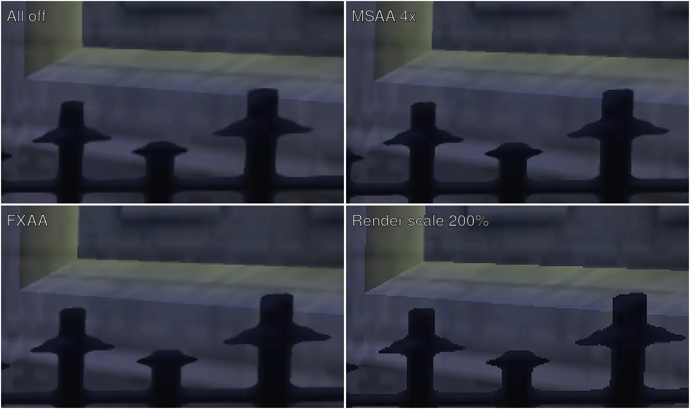
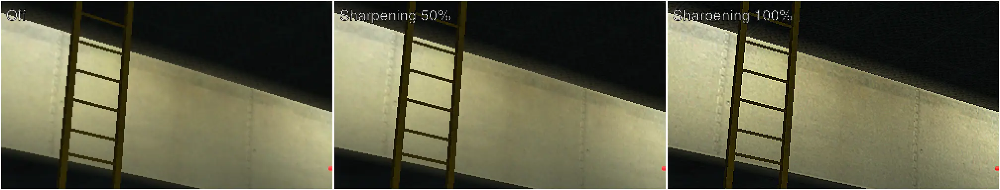

# 007: Agent Under Fire - XBE Recomp

An unofficial native PC port of the original Xbox version of 007: Agent Under Fire. The game's own x86 code
is statically recompiled with the [Xbox XBE Recomp](https://github.com/TGP482/XboxXBE-Recomp) tool. It is not an emulator.

> [!NOTE]
> This project does not include any game assets. You must provide the files from your own legally acquired copy of
> the game to build and play.

## Status

Playable on Windows: on-foot missions, driving missions and mounted guns, in English, French and German. Not every later mission has been played through yet, and a multiplayer match has not been tried.

## Supported version

The European (PAL) Xbox release, title id 4541000D. `default.xbe` SHA-1 `3dbed4eb51701a53676e0ace4cdea1752dc04697`,
`bond_eng.xbe` `66aace3859a5ca9a992f2d1845c2b5f5265fd9d6`, `bond_fre.xbe` `87b2d3c8b7b40916fe29b03490c84c4f690a4c12`,
`bond_ger.xbe` `88d06191f3ba940394f258f138f0aa37f1ced1dd`, `DRIVING.XBE` `6b58e61ee8ce9aa2a1a357affe188af874cf05f4`.

## Features

Set in the F1 window (or `settings.toml` beside the exe); the runtime's own display, graphics and controller options are there too.

- **Widescreen** - True proportions on any frame wider than 4:3, with the 3D view widened and the menus and HUD kept in a 4:3 centre. The console's own 4:3 picture is kept on a 4:3 screen.
- **Auto-aim** - The game's aim assist is off by default; the F1 window turns it back on.
- **Field of view** - 50 to 150% of the game's, on foot and driving.
- **Skip intro movies** - Starts without the logos.
- **60 FPS on foot** - Paced by the frame rate cap in the F1 window, 60 by default, instead of the console's 30.
- **Mouse and keyboard** - The mouse looks directly on foot and aims mounted guns directly, works the menus, and zooms a scope with the wheel. Menus and hints on foot show your keys. On-foot menus show a pointer: the item under it highlights and a click selects it.
- **PC Settings** - In the game's own menus: a row on the main menu and a tab on the pause screen, on foot and driving, with pages for graphics, display, controls and game. Key bindings and the rest are in the F1 window.
- **Menu pointer** - In the menus and pause screens the item under the mouse highlights and a click selects it.
- **Languages** - English, French and German, chosen in the settings window (F1), at the next start.
- **Achievements** - Each mission, medals, and every gold and platinum.
- **Sharp 2D** - Text and HUD pictures enlarged with sharp edges.

  
   
  <i>PC Settings as a tab of the pause screen, on foot and driving.</i>

  
   
  <i>And from the main menu.</i>

### Keyboard and mouse

| Control | On foot | Driving | On a mounted gun |
| --- | --- | --- | --- |
| Move / steer | W S forward and back, A D strafe | W gas, S brake, A D steer | |
| Look | Mouse | | Mouse |
| Fire | Left button | Left button | Left button |
| Manual aim / zoom | Right button | | Right button |
| Jump | Space | | |
| Crouch | C, Left Ctrl | | |
| Action, reload, open | E, R | | R reload |
| Use gadget | G | Right button, E | |
| Alt. fire | F, Middle button | | |
| Weapon | Wheel, Q, 1 next, 3 before | Wheel, Q, Z, 1 2 | |
| Gadget | 2 next, arrows left and right | 3 4 | |
| Handbrake | | Space | |
| Camera / look back | Tab, V center view | C camera, V look back | |
| Pause | Esc, P | Esc, P | Esc, P |
| Menus | Enter, left button select; Backspace, right button back; wheel, arrows move | the same | |

Keys can be changed in the F1 window.

## Graphics settings

In PC Settings or the settings window (F1, Graphics). These are shots of one spot at 3440x1440, taken one after another and lined up, so anything moving differs between them.

  
   
  <i>All off vs. render scale 200%, MSAA 4x and sharpening.</i>

  
   
  <i>Edges, enlarged three times.</i>

- **MSAA** smooths the edges of the 3D scene and keeps textures sharp. The more samples, the slower.
- **FXAA** smooths the finished frame, HUD included, and softens it a little.
- **Render scale** draws the picture larger than the screen: the smoothest fine detail, and the slowest.

  
   
  <i>Sharpening, enlarged twice.</i>

- **Sharpening** makes the picture crisper. Around 50% is a good start.

## Building

1. Clone with submodules: `git clone --recurse-submodules https://github.com/hk21x/007-agentunderfire-recomp`.
2. Extract your disc into `assets` (`default.xbe`, `bond_eng.xbe`, `bond_fre.xbe`, `bond_ger.xbe`, `DRIVING.XBE`, `assets\`, `driving.dat\`).
3. Install Visual Studio 2022 with C++ desktop development and run `build.bat`. The exes are in `out\build\release`.
   Run `AgentUnderFire.exe`; it starts the others itself.

The game is five programs (the launcher and movies, the game in each of three languages, and the driving levels), and the build recompiles them all, which takes a while.
